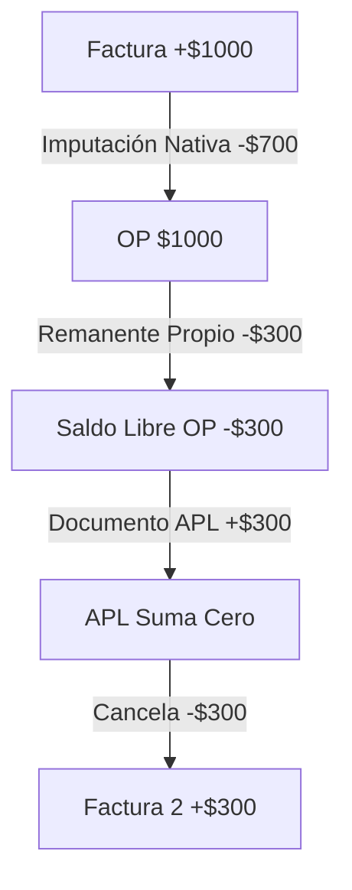

# PROYECTO — SISTEMA DE CUENTAS CORRIENTES DE PROVEEDORES
**Versión:** 1.0 (Validada contra código real)  
**Estado:** Documento Maestro Oficial del Sistema  
**Última actualización:** 31 de Agosto de 2026

---

## 1. Objetivo y Alcance `[IMPLEMENTADO]`

El sistema de **Cuentas Corrientes de Proveedores** es una plataforma integral para registrar, imputar, consultar, proyectar y auditar la totalidad de las obligaciones y créditos comerciales y financieros entre la empresa y sus proveedores.

### Pilares Fundamentales:
1. **Transparencia y Simplicidad Contable:** Saldos comprensibles de forma inmediata mediante sumas algebraicas directas.
2. **Inmutabilidad Absoluta:** Hecho económico confirmado no se borra ni se edita; toda corrección se efectúa mediante contra-asientos compensatorios auditados.
3. **Ledger de Movimientos Firmados:** Fuente de verdad económica basada en líneas de movimiento con signo explícito (+ Débitos / - Créditos).
4. **Segregación Estricta por Moneda:** Cada proveedor mantiene cuentas corrientes independientes por moneda (`provider_id + currency`), sin mezclas ni conversiones automáticas.
5. **Módulo Comercial de Vendedores:** Atribución flexible N:M entre proveedores, vendedores y comprobantes, garantizando la reconciliación matemática del saldo total.
6. **Automatización e Ingesta Inteligente:** 4 canales de entrada con soporte OCR/IA mediante OpenAI Structured Outputs y captura móvil mediante QR efímero.

---

## 2. Principios Generales de Diseño `[IMPLEMENTADO]`

### 2.1. Inmutabilidad Lógica y Protección de Datos
- **Prohibición de `ON DELETE CASCADE`:** Ninguna relación de negocio o tabla económica utiliza borrado en cascada (`ON DELETE RESTRICT` universal).
- **Bloqueo por Trigger:** El trigger PostgreSQL `trg_enforce_document_immutability` prohíbe la modificación de campos económicos (`supplier_id`, `document_type_id`, `letter`, `point_of_sale`, `document_number`, `issue_date`, `currency`, `exchange_rate`, `total_amount`, `status`) una vez que el documento pasa al estado `CONFIRMED`.
- **Restricción RLS:** Las políticas de Row Level Security deniegan la operación `DELETE` sobre comprobantes y auditorías.

### 2.2. Trazabilidad Completa
Todo registro en la base de datos conserva:
- Identificador del usuario emisor (`created_by`) y confirmador (`confirmed_by`).
- Timestamps de auditoría (`created_at`, `confirmed_at`, `changed_at`).
- Justificación descriptiva obligatoria en operaciones excepcionales (duplicados forzados, cambios de vendedor, desimputaciones y reversiones).

---

## 3. Arquitectura del Modelo de Datos `[IMPLEMENTADO]`

El sistema separa estrictamente la **Cabecera Documental**, los **Renglones Económicos (Ledger)** y las **Relaciones de Auditoría**.

```
  ┌────────────────────────────────────────────────────────┐
  │                 documents (Cabecera)                   │
  │  id, supplier_id, seller_id, document_type_id, status, │
  │  letter, point_of_sale, document_number, total_amount  │
  └───────────────────────────┬────────────────────────────┘
                              │ 1:N
                              ▼
  ┌────────────────────────────────────────────────────────┐
  │              account_movements (Ledger)                │
  │  id, supplier_id, document_id, reference_id,           │
  │  movement_type, movement_date, currency, amount (+/-)  │
  └────────────────────────────────────────────────────────┘
```

### 3.1. Entidades Principales

#### A. Proveedores (`suppliers`)
Representa la persona jurídica o física titular de la cuenta corriente.
- Clave primaria: `id bigint`.
- Identificación fiscal: `tax_id varchar(20) UNIQUE` (formato CUIT argentino validado por Módulo 11).
- Código interno: `code varchar(30) UNIQUE` (ej. `PRV-001`).

#### B. Documentos / Comprobantes (`documents`)
Entidad administrativa que agrupa los metadatos comerciales y fiscales.
- `id`: Identificador técnico interno `bigint`.
- `human_reference`: Identificación amigable (ej. `FAC A 0001-00001234`, `OP 0001-00000500`, `APL-120-142030`).
- `status`: Estado del ciclo de vida (`DRAFT`, `CONFIRMED`).
- `seller_id`: Vendedor asociado al comprobante (`NULL` en OPs y APLs).
- `total_amount`: Importe facial positivo del comprobante.

#### C. Ledger de Movimientos (`account_movements`)
El **source of truth** económico del sistema.
- `document_id`: Documento que emite o genera la transacción.
- `reference_id`: Documento económico cuyo saldo es afectado.
- `movement_type`: Tipo de movimiento (`ORIGIN`, `IMPUTATION`, `REMAINDER`, `APL_TRANSFER`, `REVERSAL`, `DESIMPUTATION`).
- `currency`: Moneda de la transacción (`ARS`, `USD`, `EUR`).
- `amount`: Importe con signo algebraico (+ Débito / Deuda, - Crédito / Pago).

---

## 4. Dinámica Contable y Operaciones `[IMPLEMENTADO]`

### 4.1. Fórmulas de Saldo
$$\text{Saldo Global Proveedor}(P, M) = \sum_{\substack{\text{supplier\_id}=P \\ \text{currency}=M}} \text{account\_movements.amount}$$

$$\text{Saldo Pendiente de un Documento}(R) = \sum_{\text{reference\_id}=R} \text{account\_movements.amount}$$

- **Factura sin pagar:** `reference_balance = total_amount` $\rightarrow$ Estado `PENDING`.
- **Factura parcialmente pagada:** `0 < reference_balance < total_amount` $\rightarrow$ Estado `PARTIAL`.
- **Factura cancelada:** `reference_balance = 0` $\rightarrow$ Estado `PAID`.
- **Crédito disponible (OP libre / NC / Anticipo):** `reference_balance < 0` $\rightarrow$ Estado `AVAILABLE_CREDIT`.

---

### 4.2. Escenarios Operativos Canónicos



#### 1. Emisión de Factura (Débito)
- Se crea comprobante `FAC A 0001-00001001` por `$1.000,00`.
- Renglón en Ledger: `document_id = 100, reference_id = 100, amount = +1000.00, type = 'ORIGIN'`.
- Saldo Factura: `+$1.000,00`. Saldo Proveedor: `+$1.000,00`.

#### 2. Orden de Pago con Imputación Nativa y Remanente
- Se emite `OP 0001-00002001` por `$1.000,00`, cancelando `$700,00` de la Factura anterior y dejando `$300,00` libres:
  - Renglón 1: `doc_id = 200, ref_id = 100, amount = -700.00, type = 'IMPUTATION'`.
  - Renglón 2: `doc_id = 200, ref_id = 200, amount = -300.00, type = 'REMAINDER'`.
- Saldo Factura 100: `+1000 - 700 = +$300,00` (`PARTIAL`).
- Saldo OP 200: `-$300,00` (`AVAILABLE_CREDIT`).
- Saldo Global Proveedor: `+1000 - 700 - 300 = $0,00`.

#### 3. Aplicación Posterior mediante Documento APL
- Llega `FAC A 0001-00001002` por `$300,00` (`ref_id = 300, amount = +300.00`).
- Se genera documento `APL-200-xxxx` para absorber el crédito libre de la OP #200:
  - Renglón 1: `doc_id = 400 (APL), ref_id = 200 (OP), amount = +300.00, type = 'APL_TRANSFER'` (Consume el crédito).
  - Renglón 2: `doc_id = 400 (APL), ref_id = 300 (FAC), amount = -300.00, type = 'APL_TRANSFER'` (Cancela la factura).
- **Propiedad Invariante de APL:** $\sum \text{amount}(\text{APL}) = +300 - 300 = 0.00$. El saldo global no varía.

#### 4. Desimputación (Reversión de Imputación Errónea)
- Si una imputación fue errónea, se genera un contra-asiento APL compensatorio:
  - Renglón 1: `doc_id = APL_REV, ref_id = FAC_ID, amount = +monto, type = 'DESIMPUTATION'` (Restaura deuda en factura).
  - Renglón 2: `doc_id = APL_REV, ref_id = OP_ID, amount = -monto, type = 'DESIMPUTATION'` (Restaura crédito libre en OP).
- Historial inalterado, trazabilidad preservada.

#### 5. Reversión Documental Compensatoria (Anulación de Factura)
- Mediante `rpc_reverse_document`, se genera un documento inverso `REV-xxx` (`AJUSTE_CREDITO` o `AJUSTE_DEBITO`) que extingue el comprobante original.

---

## 5. Módulo Comercial de Vendedores `[IMPLEMENTADO]`

### 5.1. Relación Proveedor N : M Vendedor
- Tablas: `sellers` y `supplier_sellers`.
- La vinculación soporta vigencia temporal (`valid_from`, `valid_to`) y estado `is_active`.
- Restricción única parcial: Un proveedor no puede tener relaciones activas abiertas duplicadas con el mismo vendedor.

### 5.2. Reglas de Asignación en Comprobantes
1. **Proveedor con 0 vendedores:** `documents.seller_id` queda en `NULL`.
2. **Proveedor con 1 único vendedor vigente:** El sistema lo preselecciona automáticamente.
3. **Proveedor con múltiples vendedores vigentes:** Selección obligatoria por el operador (validado en frontend y backend).
4. **Validación Server-side:** `rpc_create_and_confirm_document` comprueba que el vendedor tenga relación activa y válida para la fecha de emisión del comprobante (`issue_date`).

### 5.3. Principio de Neutralidad en Pagos y Créditos
- **Las Órdenes de Pago pertenecen al proveedor, no al vendedor:** En la cabecera de la OP, `seller_id = NULL`.
- **Los créditos libres sin aplicar (`reference_balance < 0` y `seller_id IS NULL`)** forman parte de la cuenta general del proveedor y no se atribuyen arbitrariamente a ningún vendedor.

### 5.4. Reconciliación Matemática de Saldos
El sistema garantiza que:
$$\text{Saldo Neto Proveedor} = \sum \text{Saldos Vendedores} + \text{Deuda Sin Vendedor} + \text{Créditos Libres}$$

Implementado y validado en la función `rpc_get_supplier_seller_breakdown`.

### 5.5. Cambio Auditado de Vendedor (`document_seller_history`)
Permite corregir o regularizar el vendedor de un comprobante:
- `HISTORICAL_ASSIGNMENT`: Cuando el documento tenía `seller_id IS NULL` (requiere permiso `documents.assign_seller`).
- `CORRECTION`: Cuando ya tenía vendedor asignado (requiere permiso `documents.change_seller`).
- Exige motivo descriptivo obligatorio ($\ge 5$ caracteres).
- Clasifica la relación según vigencia (`VALID_FOR_DOCUMENT_DATE`, `CURRENT_RELATION_OUTSIDE_DOCUMENT_DATE`, `HISTORICAL_RELATION_OUTSIDE_DOCUMENT_DATE`).
- Tabla append-only protegida por trigger contra modificaciones o borrados.
- **Invariante contable:** Cambiar el vendedor en la cabecera actualiza la atribución analítica sin alterar los importes del Ledger.

---

## 6. Aging y Proyección de Pagos `[IMPLEMENTADO]`

### 6.1. Aging de Proveedores y Vendedores
Implementado en `rpc_get_supplier_aging` y `rpc_get_seller_aging`:
- **Buckets estándar:**
  - Vencidos > 60 días (`overdue_gt_60`)
  - Vencidos 31 a 60 días (`overdue_31_60`)
  - Vencidos 1 a 30 días (`overdue_1_30`)
  - A vencer 0 a 30 días (`due_0_30`)
  - A vencer 31 a 60 días (`due_31_60`)
  - A vencer > 60 días (`due_gt_60`)
  - Sin fecha de vencimiento (`no_due_date_amount`)
  - Créditos libres no aplicados (`free_credits_amount`)
- **Dimensiones:** Conmutación dinámica entre vista por Proveedores y vista por Vendedores.
- **Drilldown:** Apertura de modal con el listado detallado de comprobantes que componen cada celda.

### 6.2. Proyección Financiera de Pagos
Implementado en `rpc_get_payment_projection` y `rpc_get_seller_payment_projection`:
- Agrupación por **semanas calendario de lunes a domingo** (`DATE_TRUNC('week')`).
- Categorías: `OVERDUE` (vencidos), `WEEK` (semanas futuras dinámicas), `NO_DUE_DATE` (sin vencimiento).
- Filtros opcionales por rango de fechas (`date_from`, `date_to`), moneda y texto.

---

## 7. Ingesta de Comprobantes y Automatización IA `[IMPLEMENTADO]`

El sistema ofrece 4 modalidades de carga convergentes en el formulario canónico `DocumentFormModal`:

```
┌─────────────────┐ ┌─────────────────┐ ┌─────────────────┐ ┌─────────────────┐
│  Carga Manual   │ │   Archivo PDF   │ │  Imagen Escaneo │ │   Captura Móvil │
│  (Formulario)   │ │  (Desde la PC)  │ │  (JPG/PNG/WEBP) │ │    (Código QR)  │
└────────┬────────┘ └────────┬────────┘ └────────┬────────┘ └────────┬────────┘
         │                   │                   │                   │
         └───────────────────┼───────────────────┼───────────────────┘
                             ▼
               ┌───────────────────────────────┐
               │    Edge Function IA / OCR     │
               │  extract-invoice (gpt-4o-mini)│
               └──────────────┬────────────────┘
                              ▼
               ┌───────────────────────────────┐
               │  DocumentFormModal Canónico   │
               │  • Validación CUIT Módulo 11  │
               │  • Alta Rápida de Proveedor   │
               │  • Detección de Duplicados    │
               │  • Selección de Vendedor      │
               └──────────────┬────────────────┘
                              ▼
               ┌───────────────────────────────┐
               │     account_movements (DB)    │
               └───────────────────────────────┘
```

### 7.1. Captura Móvil vía Código QR
1. La PC invoca `rpc_create_upload_session` generando un token criptográfico de 64 caracteres hex (`token_hash` SHA-256 almacenado en `document_upload_sessions` con vigencia de 15 minutos).
2. El operador escanea el QR desde su celular abriendo `/mobile-capture/:token`.
3. El móvil utiliza la cámara nativa (`capture="environment"`), previsualiza y sube el archivo directo al Storage mediante `rpc_submit_mobile_upload`.
4. La PC detecta la subida en tiempo real y transfiere el archivo a la extracción por IA.

### 7.2. Extracción Estructurada con IA
- Edge Function `supabase/functions/extract-invoice` con OpenAI Structured Outputs (`json_schema`).
- Extrae: Proveedor (CUIT, Razón Social, Fantasía), Documento (Tipo, Letra, POS, Número, Fechas, Moneda, Importe, CAE), `uncertain_fields`, `warnings` y `missing_fields`.
- Registra la traza completa en `document_ai_extractions`.
- Dispone de fallback inteligente en cliente para operar sin interrupciones.

### 7.3. Alta Rápida de Proveedor (`rpc_quick_create_supplier`)
Si el comprobante pertenece a un emisor no registrado, el operador puede darlo de alta instantáneamente desde el modal con validación estricta de CUIT argentino sin abandonar el flujo de carga.

---

## 8. Seguridad y Control de Acceso (RBAC + RLS) `[IMPLEMENTADO]`

### 8.1. Roles del Sistema
- **ADMIN:** Control total, configuración de roles, permisos y tipos de documentos.
- **ENCARGADO:** Operaciones avanzadas, reversión de comprobantes, desimputaciones, override de duplicados, asignación y cambio de vendedores, ABM de proveedores.
- **OPERADOR:** Carga de comprobantes, revisión de IA, confirmación de documentos ordinarios, imputación nativa en OP, consulta de cuentas corrientes.

### 8.2. Catálogo de Permisos Granulares
1. `documents.view`: Visualizar comprobantes y estados de cuenta.
2. `documents.create`: Crear borradores manuales o subir archivos.
3. `documents.ai_review`: Revisar y confirmar datos derivados de IA.
4. `documents.confirm`: Confirmar comprobantes e impactar en cuenta corriente.
5. `documents.edit_meta`: Editar observaciones o datos no económicos de documentos confirmados.
6. `documents.reverse`: Generar documentos compensatorios de reversión.
7. `documents.duplicate_override`: Autorizar confirmación de duplicados con justificación auditada.
8. `documents.assign_seller`: Asignar vendedor inicial a comprobantes sin vendedor (`seller_id IS NULL`).
9. `documents.change_seller`: Corregir o cambiar el vendedor asignado a un comprobante.
10. `applications.create`: Crear imputaciones/aplicaciones entre documentos.
11. `applications.desimpute`: Desimputar o revertir aplicaciones existentes.
12. `suppliers.view`: Consultar proveedores y contactos.
13. `suppliers.manage`: Crear, editar o desactivar proveedores.
14. `sellers.view`: Visualizar vendedores y asignaciones.
15. `sellers.manage`: Crear, editar o desactivar vendedores.
16. `seller_supplier.manage`: Vincular o desvincular relaciones proveedor-vendedor.
17. `audit.view`: Consultar logs de auditoría técnica y funcional.
18. `system.manage`: Gestionar usuarios, roles, permisos y tipos de comprobantes.

---

## 9. Interfaz de Usuario y Navegación `[IMPLEMENTADO]`

Estructura del Sidebar (`src/config/navigation.ts`):
- **Cuentas Corrientes:**
  - *Cuentas Corrientes:* Estado de cuenta por proveedor, vista agrupada por comprobante, vista Ledger cronológica con saldo acumulado, desglose por vendedores.
  - *Saldo General (Aging):* Matriz de antigüedad de deuda por Proveedores y por Vendedores con drilldown.
  - *Proyección de Pagos:* Planificación semanal de pagos con filtros de fechas y monedas.
- **Maestros:**
  - *Proveedores:* Catálogo de proveedores, contactos y vinculaciones.
  - *Vendedores:* Catálogo de vendedores, asignaciones activas e histórico de relaciones.
  - *Tipos de Comprobantes:* Parametrización de naturaleza (Débito/Crédito/Neutro) y comportamiento contable.
- **Administración & Seguridad:**
  - *Usuarios & Seguridad:* Gestión de perfiles, roles y asignación de permisos.
  - *Auditoría:* Registro de duplicados forzados, extracciones de IA y cambios de vendedores.

---

## 10. Stack Tecnológico `[IMPLEMENTADO]`

- **Frontend:** React 18, TypeScript, Tailwind CSS, Vite, Lucide Icons.
- **Backend / Base de Datos:** Supabase, PostgreSQL 15, PL/pgSQL, Row Level Security (RLS).
- **Serverless / IA:** Supabase Edge Functions (Deno runtime), OpenAI API (`gpt-4o-mini` Structured Outputs).
- **Almacenamiento:** Supabase Storage (Bucket privado `supplier-documents`).
- **Autenticación:** Supabase Auth + tabla de perfiles sincronizada (`profiles`).

---

## 11. Decisiones Arquitectónicas y Funcionales Pendientes `[PENDIENTE]`

Las siguientes definiciones requieren revisión y acuerdo humano:

1. **Consolidación de Migraciones Base:** Integrar formalmente la sentencia DDL de `account_movements` y el RPC `rpc_reverse_imputation` en las migraciones SQL reproducibles del repositorio.
2. **Políticas de Cambio de Vendedor en Períodos Cerrados:** Definir si existirá un bloqueo temporal para modificar el vendedor de facturas saldadas de ejercicios anteriores.
3. **Gestión de Retenciones Impositivas en Órdenes de Pago:** Ratificar si las retenciones (Ganancias, IIBB, SUSS) se cargan como comprobantes independientes de tipo `RETENCION` (`CREDIT`) o se incorporarán como campos analíticos en la cabecera de la OP.
4. **Consolidación Multimoneda Analítica:** Definir si a futuro se agregará un convertidor a moneda base de reporte con fines informativos en el Aging, manteniendo la estricta segregación contable original.
